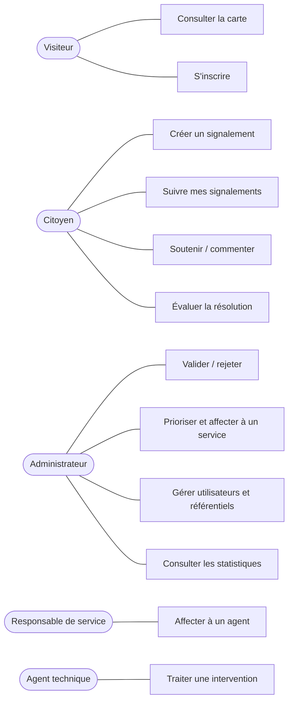
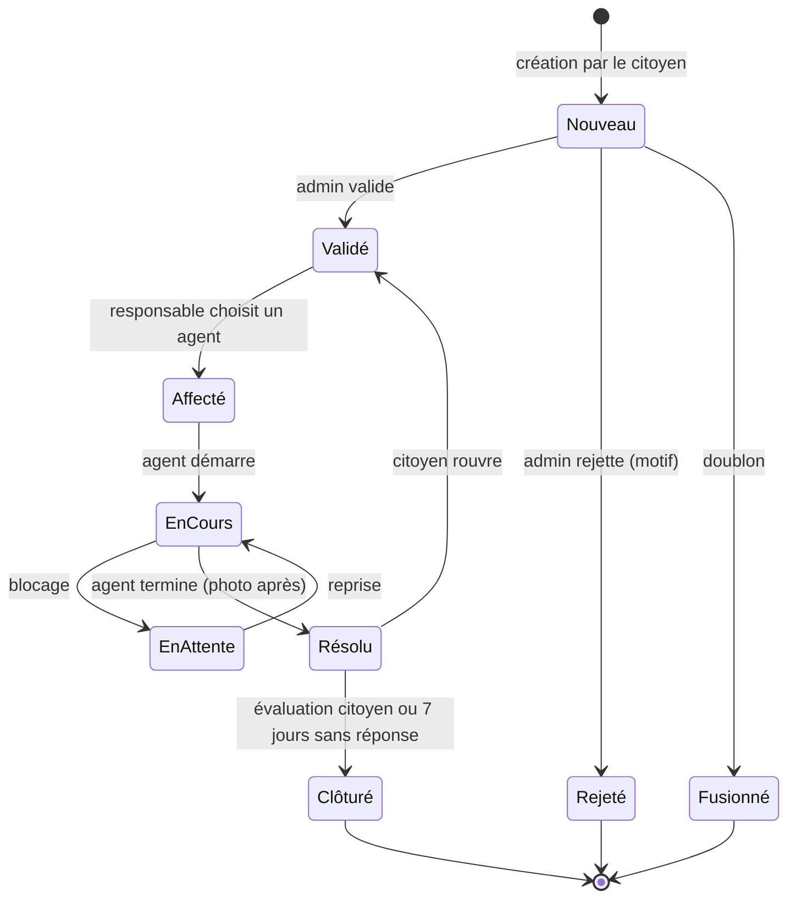
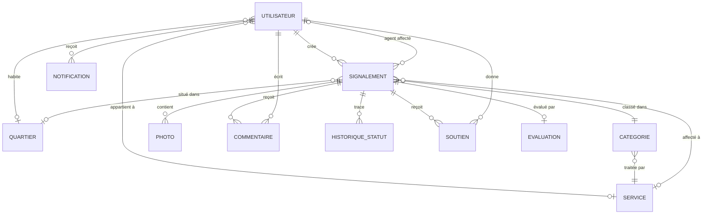
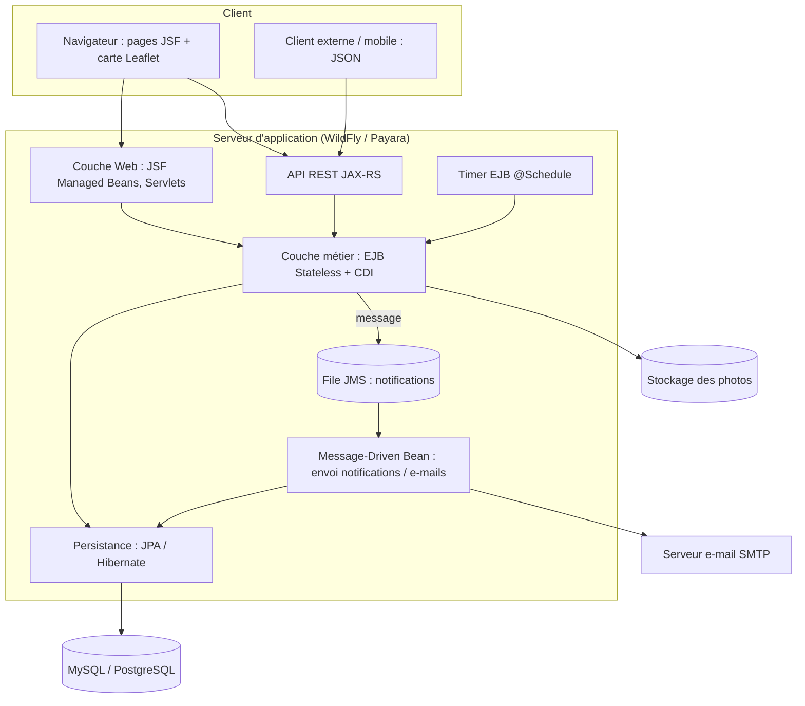

# UrbanSignal — Cahier des charges

> Application web distribuée (J2EE / Jakarta EE) permettant aux habitants de signaler les problèmes urbains de leur quartier et aux services municipaux de les traiter.
> Module : Développement distribué — Groupe de 5 étudiants.

## Sommaire

1. [Présentation du projet](#1-présentation-du-projet)
2. [Objectifs](#2-objectifs)
3. [Acteurs et rôles](#3-acteurs-et-rôles)
4. [Catégories de problèmes](#4-catégories-de-problèmes)
5. [Fonctionnalités détaillées](#5-fonctionnalités-détaillées)
6. [Cas d'utilisation](#6-cas-dutilisation)
7. [Cycle de vie d'un signalement](#7-cycle-de-vie-dun-signalement)
8. [Règles métier](#8-règles-métier)
9. [Modèle de données](#9-modèle-de-données)
10. [Architecture technique distribuée](#10-architecture-technique-distribuée)
11. [API REST](#11-api-rest)
12. [Écrans de l'application](#12-écrans-de-lapplication)
13. [Exigences non fonctionnelles](#13-exigences-non-fonctionnelles)
14. [Sécurité](#14-sécurité)
15. [Tests](#15-tests)
16. [Organisation de l'équipe (5 membres)](#16-organisation-de-léquipe-5-membres)
17. [Planning](#17-planning)
18. [Livrables](#18-livrables)
19. [Évolutions futures](#19-évolutions-futures)

---

## 1. Présentation du projet

**UrbanSignal** est une plateforme qui centralise le signalement des problèmes urbains d'un quartier : nids-de-poule, lampadaires en panne, déchets non ramassés, fuites d'eau, trottoirs dégradés, feux défectueux, etc.

- Le **citoyen** signale un problème en quelques secondes (catégorie, description, photo, position sur la carte).
- La **municipalité** reçoit le signalement, le valide, le priorise et l'affecte au service compétent.
- L'**agent technique** intervient et met à jour l'état jusqu'à la résolution.
- Le citoyen **suit l'avancement** et reçoit une notification à chaque étape.

## 2. Objectifs

| Objectif | Indicateur de réussite |
|---|---|
| Simplifier le signalement | Un signalement créé en moins d'une minute |
| Centraliser les informations | 100 % des signalements dans une seule base, géolocalisés |
| Rendre le traitement transparent | Chaque signalement a un statut visible et un historique |
| Accélérer les interventions | Délai moyen de résolution mesuré et affiché |
| Aider la municipalité à décider | Tableau de bord par catégorie, zone, période |
| Mettre en pratique le développement distribué | Architecture multi-couches J2EE : EJB, JPA, JMS, REST |

## 3. Acteurs et rôles

| Acteur | Description | Droits principaux |
|---|---|---|
| **Visiteur** (non connecté) | Toute personne qui consulte le site | Voir la carte publique et les signalements validés, s'inscrire |
| **Citoyen** | Habitant inscrit (étudiant, enseignant, commerçant, résident…) | Créer, suivre, commenter, soutenir des signalements ; évaluer la résolution |
| **Agent technique** | Employé d'un service municipal (voirie, éclairage, propreté…) | Voir ses interventions, changer le statut, ajouter des photos « après » |
| **Responsable de service** | Chef d'un service technique | Affecter les signalements de son service aux agents, suivre la charge de travail |
| **Administrateur municipal** | Gestionnaire de la plateforme côté commune | Valider / rejeter, prioriser, affecter à un service, gérer utilisateurs, catégories, quartiers ; voir les statistiques |

> Un utilisateur a **un seul rôle**. L'administrateur crée les comptes agents et responsables ; les citoyens s'inscrivent eux-mêmes.

## 4. Catégories de problèmes

| Catégorie | Exemples | Service responsable |
|---|---|---|
| Voirie | Nid-de-poule, chaussée fissurée, trottoir cassé | Service Voirie |
| Éclairage public | Lampadaire en panne, éclairage insuffisant | Service Éclairage |
| Propreté | Déchets non ramassés, dépôt sauvage, poubelle pleine | Service Propreté |
| Eau et assainissement | Fuite d'eau, égout bouché, inondation | Service Eau |
| Signalisation | Feu en panne, panneau tombé, marquage effacé | Service Voirie |
| Espaces verts | Arbre tombé, parc mal entretenu | Service Espaces verts |
| Mobilier urbain | Banc cassé, abribus endommagé | Service Voirie |
| Sécurité / Autre | Câble électrique dénudé, animal errant, autre | Administrateur (tri manuel) |

Les catégories sont **paramétrables** par l'administrateur (ajout, modification, désactivation, service associé).

## 5. Fonctionnalités détaillées

Priorités (méthode MoSCoW) : **M** = Must (obligatoire), **S** = Should (important), **C** = Could (bonus).

### 5.1 Gestion des comptes et authentification

| ID | Fonctionnalité | Acteur | Priorité |
|---|---|---|---|
| F01 | Inscription citoyen (nom, prénom, e-mail, mot de passe, téléphone, quartier) | Visiteur | M |
| F02 | Connexion / déconnexion | Tous | M |
| F03 | Gestion des rôles et contrôle d'accès aux pages et à l'API | Système | M |
| F04 | Modifier son profil et son mot de passe | Utilisateur connecté | M |
| F05 | Mot de passe oublié (lien de réinitialisation par e-mail) | Utilisateur | S |
| F06 | Vérification de l'adresse e-mail à l'inscription | Citoyen | C |
| F07 | Créer / modifier / désactiver les comptes agents et responsables | Admin | M |
| F08 | Bloquer un citoyen abusif (faux signalements, insultes) | Admin | S |

### 5.2 Signalements (côté citoyen)

| ID | Fonctionnalité | Priorité |
|---|---|---|
| F10 | Créer un signalement : titre, catégorie, description, adresse, position GPS (clic sur la carte ou géolocalisation du navigateur) | M |
| F11 | Joindre 1 à 3 photos (JPG/PNG, 5 Mo max chacune) | M |
| F12 | Détection des doublons : avant validation, afficher les signalements proches (même catégorie, rayon de 50 m) et proposer de les soutenir | S |
| F13 | Voir la liste de **mes signalements** avec leur statut | M |
| F14 | Voir le détail d'un signalement : photos, carte, statut, historique, commentaires | M |
| F15 | Modifier ou supprimer son signalement tant qu'il est à l'état **Nouveau** | M |
| F16 | **Soutenir** (« Moi aussi ») un signalement existant — augmente sa priorité | S |
| F17 | Commenter un signalement | S |
| F18 | Évaluer la résolution (note 1–5 + commentaire) quand le signalement est **Résolu** | S |
| F19 | Rouvrir un signalement résolu si le problème persiste (dans les 7 jours) | C |
| F20 | Signalement anonyme (identité masquée publiquement, connue de l'admin) | C |

### 5.3 Carte et consultation publique

| ID | Fonctionnalité | Priorité |
|---|---|---|
| F25 | Carte interactive (Leaflet + OpenStreetMap) avec un marqueur par signalement, couleur selon le statut | M |
| F26 | Filtres : catégorie, statut, quartier, période | M |
| F27 | Liste paginée des signalements avec recherche par mot-clé | M |
| F28 | Regroupement des marqueurs proches (clustering) | C |
| F29 | Carte de chaleur des zones les plus touchées | C |

### 5.4 Traitement (administrateur municipal)

| ID | Fonctionnalité | Priorité |
|---|---|---|
| F30 | Liste des signalements **à valider** | M |
| F31 | Valider ou **rejeter** un signalement (motif obligatoire : doublon, hors zone, non pertinent, abusif) | M |
| F32 | Fusionner un doublon avec le signalement d'origine | S |
| F33 | Définir / modifier la **priorité** (Basse, Normale, Haute, Urgente) | M |
| F34 | Affecter le signalement à un **service** | M |
| F35 | Gérer les catégories, services et quartiers (CRUD) | M |
| F36 | Modérer les commentaires | S |

### 5.5 Interventions (responsable de service et agent)

| ID | Fonctionnalité | Acteur | Priorité |
|---|---|---|---|
| F40 | Voir les signalements affectés à son service | Responsable | M |
| F41 | Affecter un signalement à un agent avec une date prévue | Responsable | M |
| F42 | Voir **mes interventions** (liste + carte) | Agent | M |
| F43 | Passer le statut à **En cours**, puis **Résolu** | Agent | M |
| F44 | Ajouter un commentaire interne (non visible du public) | Agent / Responsable / Admin | S |
| F45 | Ajouter une photo « après intervention » (obligatoire pour passer à Résolu) | Agent | S |
| F46 | Signaler un blocage (matériel manquant, autre service nécessaire) → statut **En attente** | Agent | S |

### 5.6 Notifications

| ID | Fonctionnalité | Priorité |
|---|---|---|
| F50 | Notification dans l'application (cloche + compteur) à chaque changement de statut | M |
| F51 | E-mail au citoyen : signalement validé, rejeté, en cours, résolu | S |
| F52 | Notification à l'agent lors d'une nouvelle affectation | M |
| F53 | Notification aux personnes qui ont soutenu un signalement quand il est résolu | S |
| F54 | Envoi **asynchrone** des notifications via une file JMS | M |
| F55 | Préférences de notification (activer / désactiver les e-mails) | C |

### 5.7 Tableau de bord et statistiques

| ID | Fonctionnalité | Priorité |
|---|---|---|
| F60 | Compteurs : total, nouveaux, en cours, résolus, rejetés | M |
| F61 | Répartition par catégorie et par quartier (graphiques) | M |
| F62 | Délai moyen de résolution, global et par service | S |
| F63 | Évolution mensuelle du nombre de signalements | S |
| F64 | Classement des services (délai, satisfaction moyenne) | C |
| F65 | Export des signalements en CSV / PDF | C |
| F66 | Statistiques publiques simplifiées sur la page d'accueil | C |

### 5.8 Historique et traçabilité

| ID | Fonctionnalité | Priorité |
|---|---|---|
| F70 | Chaque changement de statut est enregistré (ancien statut, nouveau statut, auteur, date, commentaire) | M |
| F71 | Journal des actions d'administration (création de compte, rejet, suppression) | S |

## 6. Cas d'utilisation

### 6.1 Diagramme général



### 6.2 Fiches détaillées

#### UC3 — Créer un signalement
- **Acteur :** Citoyen connecté
- **Précondition :** compte actif
- **Scénario nominal :**
  1. Le citoyen clique sur « Signaler un problème ».
  2. Il choisit une catégorie et saisit un titre et une description.
  3. Il place le point sur la carte (ou utilise sa position actuelle) ; l'adresse est proposée automatiquement.
  4. Il ajoute une à trois photos.
  5. Le système affiche les signalements similaires à proximité (F12).
  6. Le citoyen confirme ; le signalement est créé avec le statut **Nouveau** et une référence unique (ex. `US-2026-000123`).
  7. Le système notifie les administrateurs.
- **Alternatives :**
  - 5a. Le citoyen reconnaît un doublon → il le soutient au lieu de créer un nouveau signalement.
  - 3a. Position hors de la zone couverte → message d'erreur.
  - 4a. Fichier trop lourd ou format invalide → message d'erreur.
- **Postcondition :** signalement enregistré et visible dans « Mes signalements ».

#### UC7 — Valider ou rejeter un signalement
- **Acteur :** Administrateur
- **Scénario nominal :** ouvre la liste « À valider » → consulte le détail → choisit **Valider**, fixe la priorité et le service → statut **Validé** → notification au citoyen et au responsable du service.
- **Alternative :** **Rejeter** avec un motif obligatoire → statut **Rejeté** → notification au citoyen avec le motif.
- **Alternative :** **Fusionner** avec un signalement existant → le citoyen devient soutien du signalement d'origine.

#### UC11 — Affecter à un agent
- **Acteur :** Responsable de service
- **Scénario :** voit les signalements validés de son service → choisit un agent disponible et une date prévue → statut **Affecté** → notification à l'agent.

#### UC12 — Traiter une intervention
- **Acteur :** Agent technique
- **Scénario nominal :** ouvre « Mes interventions » → passe le statut à **En cours** sur place → répare → ajoute une photo « après » et un commentaire → passe à **Résolu** → notification au citoyen et aux soutiens.
- **Alternative :** blocage → statut **En attente** avec motif ; le responsable est notifié.

#### UC6 — Évaluer la résolution
- **Acteur :** Citoyen auteur
- **Scénario :** reçoit la notification « Résolu » → donne une note de 1 à 5 et un commentaire → le statut passe à **Clôturé**.
- **Alternative :** problème non réglé → **Rouvrir** (F19) → retour à **Validé**.

## 7. Cycle de vie d'un signalement



| Statut | Signification | Couleur sur la carte |
|---|---|---|
| Nouveau | Créé, en attente de validation | Gris |
| Validé | Accepté, transmis à un service | Bleu |
| Affecté | Confié à un agent | Violet |
| En cours | Intervention commencée | Orange |
| En attente | Intervention bloquée | Jaune |
| Résolu | Problème réparé | Vert |
| Clôturé | Résolution confirmée | Vert foncé |
| Rejeté / Fusionné | Non retenu | Rouge (masqué par défaut) |

## 8. Règles métier

| ID | Règle |
|---|---|
| R01 | Un signalement appartient à une seule catégorie et, une fois validé, à un seul service. |
| R02 | Seules les transitions du diagramme d'états sont autorisées ; toute autre transition est refusée par la couche métier. |
| R03 | Le citoyen ne peut modifier ou supprimer son signalement que s'il est **Nouveau**. |
| R04 | Le rejet d'un signalement exige un motif. |
| R05 | Le passage à **Résolu** exige un commentaire et (si F45 est implémentée) une photo « après ». |
| R06 | Un citoyen ne peut soutenir un même signalement qu'une seule fois, et pas le sien. |
| R07 | Priorité automatique proposée : **Urgente** pour la catégorie Sécurité ; **Haute** au-delà de 10 soutiens ; l'admin peut la modifier. |
| R08 | Un citoyen est limité à 10 signalements par jour (anti-abus). |
| R09 | Un signalement **Résolu** sans évaluation passe automatiquement à **Clôturé** après 7 jours (tâche planifiée `@Schedule`). |
| R10 | Un agent ne voit et ne modifie que les signalements qui lui sont affectés ; un responsable, ceux de son service. |
| R11 | Les commentaires internes ne sont jamais visibles du citoyen. |
| R12 | La position d'un signalement doit se trouver dans le périmètre de la commune. |

## 9. Modèle de données



| Entité | Attributs principaux |
|---|---|
| **Utilisateur** | id, nom, prenom, email (unique), motDePasseHash, telephone, role (CITOYEN, AGENT, RESPONSABLE, ADMIN), actif, dateCreation, quartier, service |
| **Signalement** | id, reference, titre, description, latitude, longitude, adresse, statut, priorite, dateCreation, dateMiseAJour, dateResolution, anonyme, nbSoutiens, auteur, categorie, quartier, service, agent, signalementOrigine (fusion) |
| **Categorie** | id, nom, description, icone, actif, service |
| **Service** | id, nom, email, telephone, responsable |
| **Quartier** | id, nom, codePostal, (polygone de délimitation — optionnel) |
| **Photo** | id, chemin, type (AVANT, APRES), dateAjout, signalement |
| **Commentaire** | id, contenu, interne (booléen), date, auteur, signalement |
| **HistoriqueStatut** | id, ancienStatut, nouveauStatut, commentaire, date, auteur, signalement |
| **Soutien** | id, date, utilisateur, signalement — contrainte unique (utilisateur, signalement) |
| **Evaluation** | id, note (1–5), commentaire, date, signalement |
| **Notification** | id, message, type, lue, date, destinataire, signalement |

Énumérations : `Role`, `Statut`, `Priorite`, `TypePhoto`, `MotifRejet`.

## 10. Architecture technique distribuée

### 10.1 Vue d'ensemble



### 10.2 Couches et technologies

| Couche | Technologies | Rôle |
|---|---|---|
| Présentation | JSF (Facelets) + PrimeFaces, Bootstrap, Leaflet.js, Chart.js | Pages web, carte, graphiques |
| Web / API | Servlets (upload photos), JAX-RS (REST + JSON-B) | Point d'entrée HTTP, échanges JSON |
| Métier | EJB `@Stateless`, CDI, Bean Validation | Règles métier, transitions de statut, transactions |
| Asynchrone | JMS (Queue) + Message-Driven Bean, JavaMail | Notifications et e-mails sans bloquer l'utilisateur |
| Planification | EJB Timer `@Schedule` | Clôture automatique (R09), rappels |
| Persistance | JPA (Hibernate / EclipseLink), DAO génériques | Accès aux données |
| Base de données | MySQL ou PostgreSQL | Stockage |
| Sécurité | Jakarta Security, hachage BCrypt, rôles `@RolesAllowed`, JWT pour l'API | Authentification et autorisation |
| Build / Serveur | Maven, WildFly / Payara / GlassFish, Git + GitHub | Compilation, déploiement, versionnement |

**Pourquoi c'est distribué :** le client et le serveur communiquent par HTTP/REST, la logique métier est encapsulée dans des composants EJB réutilisables, et les notifications sont traitées de façon asynchrone par un composant indépendant (JMS/MDB). L'API REST permet aussi à d'autres clients (application mobile, autres services municipaux) d'utiliser le système.

### 10.3 Organisation du code (Maven multi-modules)

```
UrbanSignal/
├── urbansignal-ejb/          # Entités JPA, DAO, EJB métier, MDB, timers
│   └── src/main/java/ma/urbansignal/
│       ├── entity/           # Utilisateur, Signalement, Categorie, ...
│       ├── dao/              # GenericDao, SignalementDao, ...
│       ├── service/          # SignalementService, UtilisateurService, StatistiqueService, ...
│       ├── messaging/        # NotificationProducer, NotificationMDB
│       └── scheduler/        # ClotureAutomatiqueTimer
├── urbansignal-web/          # JSF, Managed Beans, ressources REST, Servlets
│   └── src/main/
│       ├── java/ma/urbansignal/web/   # beans/, rest/, servlet/, security/
│       └── webapp/           # pages .xhtml, css, js (carte)
├── urbansignal-ear/          # Packaging EAR (ejb + war)
├── docs/                     # PDF, cahier des charges, diagrammes UML
└── pom.xml                   # POM parent
```

## 11. API REST

Base : `/api/v1` — format JSON — authentification par jeton (JWT) sauf routes publiques.

| Méthode | Route | Description | Rôle |
|---|---|---|---|
| POST | `/auth/register` | Inscription citoyen | Public |
| POST | `/auth/login` | Connexion, renvoie un jeton | Public |
| GET | `/signalements` | Liste filtrée (`categorie`, `statut`, `quartier`, `page`) | Public |
| GET | `/signalements/{id}` | Détail | Public |
| GET | `/signalements/proches?lat=&lng=&rayon=` | Signalements proches (doublons) | Citoyen |
| POST | `/signalements` | Créer | Citoyen |
| PUT | `/signalements/{id}` | Modifier (si Nouveau) | Citoyen auteur |
| DELETE | `/signalements/{id}` | Supprimer (si Nouveau) | Citoyen auteur / Admin |
| POST | `/signalements/{id}/photos` | Ajouter une photo (multipart) | Citoyen / Agent |
| POST | `/signalements/{id}/soutiens` | Soutenir | Citoyen |
| POST | `/signalements/{id}/commentaires` | Commenter | Connecté |
| PATCH | `/signalements/{id}/statut` | Changer le statut (valider, rejeter, en cours, résolu…) | Admin / Agent |
| PATCH | `/signalements/{id}/affectation` | Affecter à un service ou à un agent | Admin / Responsable |
| POST | `/signalements/{id}/evaluation` | Évaluer la résolution | Citoyen auteur |
| GET | `/me/signalements` | Mes signalements | Citoyen |
| GET | `/me/interventions` | Mes interventions | Agent |
| GET | `/me/notifications` | Mes notifications | Connecté |
| GET | `/statistiques` | Indicateurs du tableau de bord | Admin |
| GET/POST/PUT/DELETE | `/categories`, `/services`, `/quartiers`, `/utilisateurs` | Référentiels et comptes | Admin |

Codes de retour : `200` OK, `201` créé, `400` données invalides, `401` non authentifié, `403` interdit, `404` introuvable, `409` transition de statut invalide.

## 12. Écrans de l'application

| # | Écran | Acteurs |
|---|---|---|
| E01 | Accueil : présentation, statistiques publiques, carte, bouton « Signaler » | Tous |
| E02 | Inscription / Connexion / Mot de passe oublié | Visiteur |
| E03 | Carte des signalements avec filtres | Tous |
| E04 | Formulaire de signalement (étapes : catégorie → description → position → photos → confirmation) | Citoyen |
| E05 | Détail d'un signalement (photos, carte, chronologie des statuts, commentaires, soutien, évaluation) | Tous |
| E06 | Mes signalements | Citoyen |
| E07 | Profil et préférences | Connecté |
| E08 | Centre de notifications | Connecté |
| E09 | Back-office : file de validation | Admin |
| E10 | Back-office : tous les signalements (tableau filtrable, actions groupées) | Admin |
| E11 | Back-office : gestion des utilisateurs | Admin |
| E12 | Back-office : catégories, services, quartiers | Admin |
| E13 | Tableau de bord statistique | Admin / Responsable |
| E14 | Signalements de mon service + affectation | Responsable |
| E15 | Mes interventions (liste + carte, mise à jour du statut) | Agent |

## 13. Exigences non fonctionnelles

| Domaine | Exigence |
|---|---|
| Performance | Pages chargées en moins de 2 s ; liste paginée (20 éléments) |
| Ergonomie | Interface simple, en français, utilisable sur mobile (responsive) |
| Disponibilité | Les notifications n'empêchent jamais la création d'un signalement (traitement asynchrone) |
| Fiabilité | Transactions gérées par le conteneur EJB ; aucune perte de changement de statut |
| Maintenabilité | Architecture en couches, code commenté, conventions Java, Git avec branches et pull requests |
| Évolutivité | API REST versionnée (`/api/v1`) pour de futurs clients |
| Accessibilité | Contraste suffisant, libellés sur les champs, navigation au clavier |
| Stockage | Photos redimensionnées (max 1600 px) et stockées hors base ; seul le chemin est en base |

## 14. Sécurité

- Mots de passe **hachés** (BCrypt), jamais stockés en clair.
- Contrôle d'accès par rôle sur les pages (filtres / contraintes de sécurité) et sur les EJB (`@RolesAllowed`).
- Vérification côté serveur qu'un utilisateur n'agit que sur ses propres données (R10).
- Validation de toutes les entrées (Bean Validation) ; requêtes JPA paramétrées (pas d'injection SQL).
- Protection XSS (échappement JSF) et CSRF (jetons JSF).
- Upload : vérification du type MIME et de la taille, renommage des fichiers.
- Sessions expirées après 30 minutes d'inactivité ; HTTPS en production.
- Masquage de l'identité de l'auteur dans les vues publiques ; respect des données personnelles (droit de suppression du compte).

## 15. Tests

| Type | Outil | Exemples |
|---|---|---|
| Unitaires | JUnit 5, Mockito | Transitions de statut autorisées / interdites (R02), calcul de priorité (R07), limite de 10 signalements par jour (R08) |
| Intégration | Arquillian ou base H2 en mémoire | DAO JPA, EJB avec transactions, MDB |
| API | Postman / REST Assured | Codes de retour, droits par rôle |
| Interface | Tests manuels (scénarios des cas d'utilisation) | Parcours complet : création → validation → affectation → résolution → évaluation |
| Données de démonstration | Script SQL `data.sql` | 5 quartiers, 8 catégories, 5 services, 1 admin, 5 agents, 10 citoyens, 50 signalements |

## 16. Organisation de l'équipe (5 membres)

| Membre | Responsabilité principale | Modules / fonctionnalités |
|---|---|---|
| Membre 1 — Chef de projet & base de données | Coordination, Git, modèle de données | Entités JPA, DAO, script SQL, intégration finale, documentation |
| Membre 2 — Comptes & sécurité | Authentification et rôles | F01–F08, sécurité, gestion des utilisateurs (E02, E07, E11) |
| Membre 3 — Signalements citoyen | Cœur métier côté citoyen | F10–F20, carte F25–F29, upload photos (E03–E06) |
| Membre 4 — Back-office & interventions | Traitement municipal | F30–F46, cycle de vie, référentiels (E09, E10, E12, E14, E15) |
| Membre 5 — Notifications, statistiques & API | Partie distribuée / asynchrone | F50–F66, JMS/MDB, Timer, API REST, tableau de bord (E08, E13) |

Tout le monde : tests de sa partie, revue de code des autres via pull requests, préparation de la soutenance.

**Règles Git :** branche `main` protégée ; une branche par fonctionnalité (`feature/F10-creation-signalement`) ; pull request relue par au moins un autre membre avant fusion.

## 17. Planning

| Semaine | Étape | Résultat attendu |
|---|---|---|
| 1 | Analyse du besoin | PDF des 3 questions, ce cahier des charges |
| 2 | Conception | Diagrammes UML (cas d'utilisation, classes, séquence, états), maquettes des écrans |
| 3 | Mise en place | Projet Maven multi-modules, serveur, base de données, entités JPA, CI de base |
| 4–5 | Sprint 1 — Must | Comptes et rôles, création et suivi des signalements, carte, validation et affectation |
| 6–7 | Sprint 2 — Should | Interventions agents, notifications JMS, historique, statistiques, API REST |
| 8 | Sprint 3 — Could et finitions | Bonus (doublons, heatmap, export), tests, corrections |
| 9 | Livraison | Rapport final, démonstration, présentation |

## 18. Livrables

1. Analyse du besoin (PDF) — `docs/Analyse_du_besoin.pdf`
2. Cahier des charges — ce document
3. Dossier de conception : diagrammes UML et maquettes
4. Code source sur GitHub (projet Maven, README d'installation)
5. Script de base de données et jeu de données de démonstration
6. Rapport final et support de présentation
7. Démonstration de l'application déployée

## 19. Évolutions futures

- Application mobile (Android / iOS) utilisant l'API REST existante.
- Notifications push et SMS.
- Classification automatique de la catégorie à partir de la photo (IA).
- Gamification : points et badges pour les citoyens actifs.
- Ouverture des données (open data) pour les chercheurs et associations.
- Gestion multi-communes.
- Intégration avec le système de gestion interne de la municipalité.
